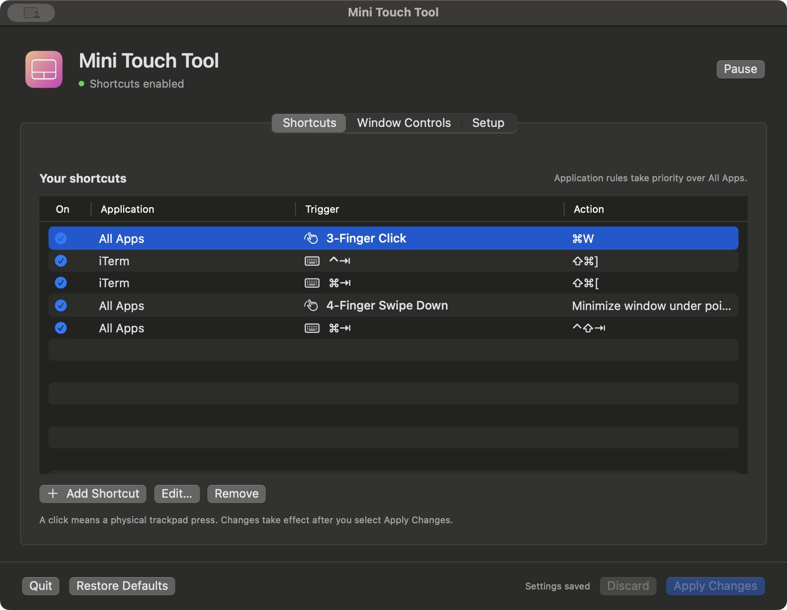
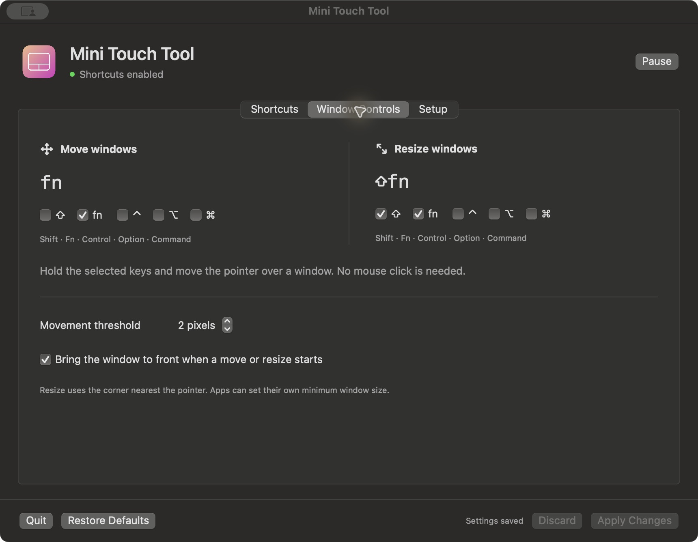

# Mini Touch Tool

A standalone macOS menu bar app for keyboard shortcuts, two trackpad gestures, and modifier-based window controls.
The app uses Swift, SwiftUI, and AppKit. It has no third-party runtime dependencies or network service.

## Install

1. Open `Mini-Touch-Tool.dmg`.
2. Drag **Mini Touch Tool** into **Applications**.
3. Open the app from Applications.
4. In **Setup**, allow **Accessibility** and **Input Monitoring** for the installed app.
5. Quit BetterTouchTool. Mini Touch Tool waits while BetterTouchTool runs.
6. If permissions still appear unavailable, quit and reopen Mini Touch Tool.

The menu bar icon opens the settings window. Its Dock icon appears while that window is open or minimized.
Use the yellow window button or Command-M to minimize it. Click the Dock icon to restore it.
Command-W and the three-finger click close settings. A four-finger swipe minimizes the window under the pointer, including settings.
Close the settings window to leave the app active in the menu bar.
Use **Setup → Launch at Login** to enable or disable startup when you sign in.
The first launch enables this option.

The personal build uses a persistent local signing certificate. It has no Apple notarization.
If macOS blocks a copy downloaded from GitHub, review it in **System Settings → Privacy & Security → Open Anyway**.
The app requests missing permissions when its settings window is active.
Releases signed with the same identity retain the existing privacy grants.
Always select `/Applications/Mini Touch Tool.app` for the initial approval. Use **Setup → Restart App** if macOS requires a restart.

**Requirements:** Apple Silicon and macOS 15 or later. The initial build was checked on macOS 15.7.1.
The operator confirmed the keyboard shortcuts, Fn controls, and both physical gestures on the target Mac.
A real logout/login startup remains unchecked.

## Default controls

| Application | Trigger | Action |
| --- | --- | --- |
| All Apps | Three-finger physical click | Command-W |
| iTerm | Control-Tab | Command-Shift-] |
| iTerm | Command-Tab | Command-Shift-[ |
| All Apps | Four-finger swipe down | Minimize the window under the pointer |
| All Apps | Command-Tab | Control-Shift-Tab |

Hold **Fn** and move the pointer to move the window under it.
Hold **Fn-Shift** and move the pointer to resize from the nearest corner.
Neither control needs a mouse click. The default movement threshold is two pixels.

## Configure

**Shortcuts** lists every rule. Select a rule and choose **Edit**.
You can change its application, trigger, action, and enabled state.
Click a key field and press the replacement shortcut.
You can also add and remove rules. Application-specific rules take priority over **All Apps**.
The gesture choices are **3-Finger Click** and **4-Finger Swipe Down**.

**Window Controls** contains separate modifier checkboxes for move and resize.
It also contains the movement threshold and the option to raise the window.
Choose **Apply Changes** to save and activate your changes.
The app refuses duplicate enabled rules and conflicting move and resize modifiers.

**Setup** contains startup, permission, and app-restart controls.
The settings window also contains **Pause**, **Restore Defaults**, and **Quit**.

## Limits

- Disable four-finger **App Exposé** in Trackpad settings if it uses the same gesture.
- If Fn opens another feature, set **Keyboard → Press Fn/🌐 key to → Do Nothing**.
- Gestures use Apple's private `MultitouchSupport.framework`. A macOS update can require changes to this code.
- Secure Input and applications without window accessibility support can prevent some controls.
- Full-screen windows stay outside the window controls. Applications enforce their own minimum window sizes.
- If you connect another trackpad while the app runs, choose **Setup → Restart App**.
- Key labels use the standard ANSI key names. The recorder stores physical key codes.

## Build

Install Xcode or its command line tools. Then run:

```sh
bash scripts/build.sh
```

The result is `build/Mini Touch Tool.app`.
Users of the compiled app do not need Xcode, a package manager, or Terminal.

The first build creates a local signing certificate and an isolated keychain.
macOS can request approval to trust that certificate for code signing by `/usr/bin/codesign` in your user account.
The private key and keychain password stay outside the repository in
`~/Library/Application Support/Mini Touch Tool Signing/`.
Keep this identity for future releases. The build stops if its stored identity is incomplete.

Create the drag-and-drop disk image and ZIP archive:

```sh
bash scripts/package.sh
```

Build outputs stay outside Git. Release assets contain the compiled app.
The app uses `SMAppService.mainApp` for login startup and macOS preferences for its settings.
The private trackpad declarations stay in `Sources/Trackpad.m`.

The application icon uses the supplied peach `#EEBD89` to magenta `#D13ABD` gradient and a white trackpad outline.
The Dock uses this gradient icon. The menu bar uses a plain trackpad outline with a transparent background.
macOS renders the menu bar outline white on dark backgrounds and dark on light backgrounds.

## Acceptance

See [the acceptance record](evidence/acceptance.md) for observed results and the repeatable live scenario.




